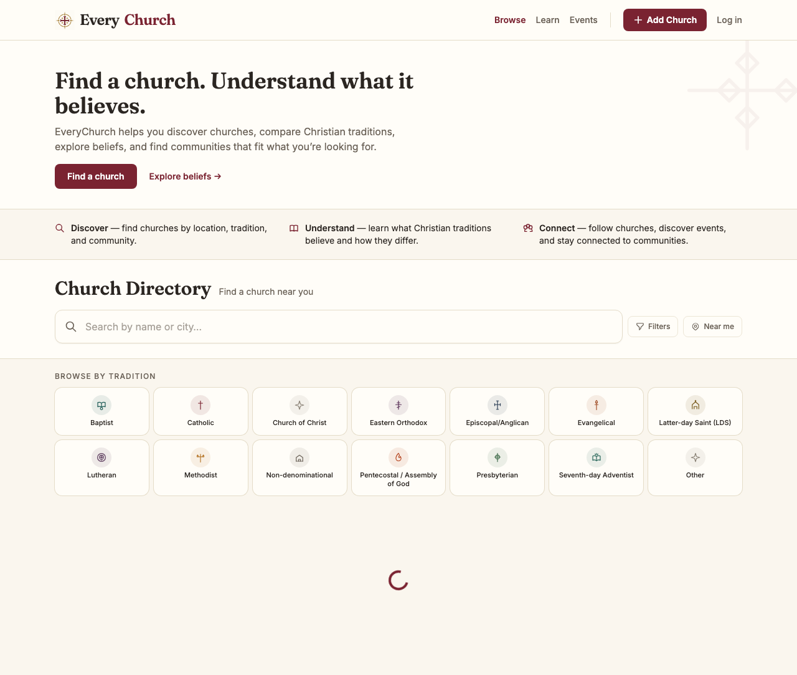
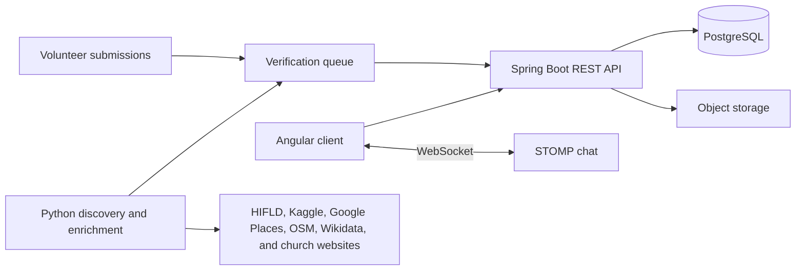

# EveryChurch

[](https://github.com/PrestonParis/everychurch/actions/workflows/ci.yml)

EveryChurch is a searchable church directory and collaboration platform that helps people understand Christian traditions, find nearby communities, and keep church information accurate.

[**Live site: everychurch.co**](https://everychurch.co) · [Architecture](docs/ARCHITECTURE.md) · [Data pipeline](docs/SCRAPER.md)



## Features

- Search and filter standardized church profiles by location, tradition, and community.
- Compare Christian traditions and explore church service times, contact details, events, sermons, and media.
- Let churches claim listings and delegate fine-grained staff permissions.
- Let church owners release a claim cleanly when leadership changes.
- Route volunteer submissions and scraped updates through an administrator-reviewed verification queue.
- Support member-only church chat with WebSocket delivery and server-side membership checks.
- Expire stale sessions in the client and protect live demos from accidental writes.
- Discover and enrich listings through a resumable Python pipeline that can run locally or in AWS Lambda.

## Architecture



The Angular application and Spring Boot API live in one Nx monorepo. PostgreSQL stores directory, identity, permission, and moderation data, with 23 versioned Flyway migrations; object storage holds uploaded media. The scraper tiles geographic areas, normalizes candidates, checks existing records, and submits changes through the same review boundary used by volunteers. WebSocket authorization reuses the platform's church membership and staff permission model instead of creating a separate trust path.

## Tech stack

- **Frontend:** Angular 21, TypeScript, Tailwind CSS, Playwright
- **Backend:** Java 21, Spring Boot 4, Spring Security, WebSocket/STOMP
- **Data:** PostgreSQL, Flyway, object storage
- **Pipeline:** Python, Requests, Beautiful Soup, AWS Lambda
- **Tooling:** Nx, Docker Compose, Pytest

## Engineering highlights

- **Geographic discovery without duplicate floods.** The scraper partitions large search areas into smaller tiles, normalizes candidates, and checks existing records before submitting them for review.
- **Human review at the write boundary.** Automated discoveries and volunteer edits enter a verification queue, keeping untrusted inputs away from published profiles.
- **Permission-aware collaboration.** Claimed churches can delegate profile, sermon, event, and staff-management capabilities without granting blanket administrative access.
- **Defensive website enrichment.** The crawler verifies church names and locations, rejects shared or social-profile URLs, resumes interrupted runs, and avoids merging schedules from unrelated pages.

## Testing

```sh
npx nx test client
npx nx e2e client-e2e
npx nx test scraper
```

The current suites include 197 backend tests, 125 frontend unit tests, and 494 scraper tests with 100% coverage, plus a three-browser public-page smoke check and three isolated end-to-end faith journeys. They cover frontend behavior, browser journeys, scraper pagination and retries, church matching, schedule extraction, and safeguards against enriching the wrong listing.

AI-assisted development was used for implementation and review; architecture, product decisions, testing, and final code ownership remain human-directed.

## Running locally

### Prerequisites

- Node.js 20+
- Java 21
- Python 3.8–3.10 and Poetry
- Docker

```sh
npm install
docker compose up -d db
cp .env.example .env
npx nx run-many --target=serve --all
```

Individual services can be started with `npx nx serve client` and `npx nx serve server`. See [docs/COMMANDS.md](docs/COMMANDS.md) for the full command reference.

## Status and next steps

EveryChurch is live and actively developed. Current work is improving nationwide data coverage, moderation workflows, belief-comparison content, and the quality of website-derived service information.

**Demo video:** TODO — add a short product walkthrough.

## Documentation

- [Architecture](docs/ARCHITECTURE.md)
- [Data model](docs/DATA_MODEL.md)
- [Scraper and data pipeline](docs/SCRAPER.md)
- [Product scope](docs/PRODUCT_SCOPE.md)
- [Faith and denomination matching](docs/FAITH_MATCHING.md)

## License

Licensed under the [MIT License](LICENSE).
